  

  
  
  
  

  
  
  

### stuff i made

  
  

### contributed to

  
  

### practicing on

### tech stack

 

  
  

<picture>
  <source media="(prefers-color-scheme: dark)" srcset="https://raw.githubusercontent.com/Perz3us/Perz3us/output/pacman-contribution-graph-dark.svg" />
  
</picture>
